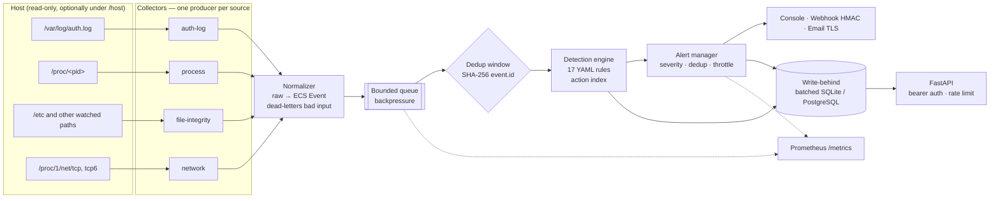

# Sentinel-Linux 2.0

[](https://github.com/RichSsa24/Sentinel_Linux2.0/actions/workflows/ci.yml)


**A host-based intrusion detection system for Linux, written in async Python.**
Four collectors watch SSH logins, processes, files and sockets; a bounded,
deduplicating pipeline feeds 17 declarative, MITRE ATT&CK-mapped rules; alerts
go out through hardened sinks; everything is queryable through an authenticated
API and Prometheus.

It is built to be *read*: every security claim below points at the code or the
test that backs it, and every number comes from a script you can re-run.

Built and maintained by **José Ricardo Solís Arias** ([@RichSsa24](https://github.com/RichSsa24)).

---

## Try it in 30 seconds

No root, no Docker — just [uv](https://docs.astral.sh/uv/):

```bash
git clone https://github.com/RichSsa24/Sentinel_Linux2.0.git && cd Sentinel_Linux2.0
uv sync
uv run sentinel demo
```

`sentinel demo` replays a scripted intrusion through the **real** pipeline —
normalizer, bounded queue, dedup window, rule engine, alert manager and a
throwaway SQLite database — mixed with benign activity and a duplicate record
(output abridged):

```text
[HIGH]     ssh-brute-force (T1110)            :: SSH brute-force login attempts
[MEDIUM]   ssh-root-login (T1078.003)         :: Successful SSH login as root
[MEDIUM]   interactive-shell-spawn (T1059.004)
[CRITICAL] reverse-shell-process (T1059.004)  :: Reverse-shell-style process invocation
[HIGH]     c2-beacon-port (T1571)             :: Outbound connection to a known C2 port
[MEDIUM]   base64-execution (T1027)
[HIGH]     suspicious-tmp-exec (T1059)
[MEDIUM]   account-creation (T1136.001)
[MEDIUM]   cron-persistence (T1053.003)
[HIGH]     new-suid-binary (T1548.001)
[HIGH]     log-tampering (T1070.002)

Replayed 19 records -> 18 events stored (1 duplicate dropped by the dedup window).
11 alerts from 11 rules; 0 alerts on the 3 benign events.
```

The demo is a test, too: [`tests/test_cli.py`](tests/test_cli.py) fails CI if
any attack step stops being detected or a benign event starts alerting.

`uv run sentinel rules` validates and lists the rule library;
`uv run sentinel serve` runs the full service.

## Architecture



Everything is assembled in one place, [`sentinel/runtime.py`](src/sentinel/runtime.py),
from validated `SENTINEL_*` settings. The design rationale is in
[ADR 0001](docs/adr/0001-architecture-overview.md); the runtime and performance
decisions in [ADR 0003](docs/adr/0003-runtime-and-performance.md).

## Engineering highlights

**Exactly-once delivery under concurrent producers.** Every event carries a
deterministic SHA-256 `event.id` derived from its content, and a single consumer
owns a TTL- and size-bounded dedup window — so a log re-read after rotation or a
double poll cannot produce a duplicate alert. A keystone test races eight
producers through shared duplicates and asserts each id reaches the consumer once
([`test_pipeline_keystone.py`](tests/test_pipeline_keystone.py)). Storage holds
the same line: a write can commit while its acknowledgement is lost, and the
retry must not store it again. Each buffered record carries a write id, unique
in the database, so the retry skips what already landed — tested against
PostgreSQL behind a proxy that withholds the reply to `COMMIT`
([`test_postgres.py`](tests/test_postgres.py)).

**Rules are data, never code.** Rules are strict YAML parsed with `safe_load`
into a closed grammar of comparison operators; the evaluator is an allow-listed
interpreter with no `eval`. Rule regexes run on the `regex` engine with a hard
timeout over bounded windows (ReDoS), and fail safe: a timeout fires the rule
rather than reading as "no match", so padding a command line cannot buy a miss.
A rule that could never fire (an unknown field, a value of the wrong type) fails
the whole library at load.
Every rule has a positive and a negative test, plus structural tests — e.g. no
process rule may fire twice for one process ([`test_detection_rules.py`](tests/test_detection_rules.py)).

**A rule index proven sound with property-based testing.** The engine derives,
by static analysis of each rule's condition tree, which `event.action` values it
could ever match, and evaluates only those rules. A Hypothesis property test over
random `all`/`any`/`not` trees checks the derivation never excludes a matching
rule — a deliberately unsound version is caught with a minimal counter-example
([`test_detection_index.py`](tests/test_detection_index.py)).

**File integrity monitoring that does not re-hash the world — and cannot be
fooled by `touch`.** Unchanged files reuse their digest when `(size, mtime,
ctime, inode, device)` is identical. `mtime` alone would be an evasion hole, but
`ctime` cannot be set from userspace; entries changed within the kernel clock's
granularity are re-hashed, as in Git's "racy clean" handling. Tests cover the
same-length-edit-then-restore-mtime attack ([`integrity.py`](src/sentinel/collectors/integrity.py)).

**Containers that see the host, not themselves.** Following the Falco/osquery
`HOST_ROOT` convention, collectors read the host under `/host` but report
host-native paths and the host's name; the network collector reads
`/proc/1/net` because `/proc/net` resolves to the *reader's* network namespace.
Verified end to end: a cron drop, a `useradd` command line and a listener on
`:4444` on the host are detected from inside the read-only container.

**Security of the detector itself.**
- Default-deny bearer auth on every data endpoint, constant-time comparison, and
  a regression test that a failed login never logs the presented or configured
  key; `X-Forwarded-For` is not trusted, and key holders have their own
  rate-limit budget ([`security.py`](src/sentinel/api/security.py)).
- Log-injection defence and secret redaction for every logger, libraries
  included, configured before anything else can log; console alerts escape
  terminal control sequences.
- Webhook sink: HTTPS only, HMAC-SHA256 signed, SSRF guard re-checked on every
  send and the connection pinned to the address it checked (DNS rebinding).
  Email: verified TLS only. Each sink has its own queue and deadline, so a hung
  channel delays nothing else.
- The throttle withholds notifications, never evidence: throttled alerts are
  stored and announced, so decoys cannot hide the real attack.
- Half-configured alert channels and weak or placeholder keys fail at startup;
  unknown `SENTINEL_*` variables are a startup error.
- Least privilege end to end: the container runs as uid 10001 with no
  capabilities on a read-only root filesystem; PostgreSQL gives Sentinel a
  non-superuser role; the systemd unit is sandboxed (`systemd-analyze
  security` exposure 1.8). Images are pinned by digest and scanned weekly.
  Threat model: [docs/THREAT_MODEL.md](docs/THREAT_MODEL.md).

## Performance

Measured with [`scripts/benchmark.py`](scripts/benchmark.py) on a 4-vCPU
x86-64 VM, Python 3.13: each figure is the median of three runs, each itself a
median of five repetitions; "before" (commit `24bb9e7`, where the benchmark was
introduced) and "after" were run alternately on the same machine. Re-run it on
your hardware.

| Hot path | Before | After | Change |
| --- | --- | --- | --- |
| End to end: collector → dedup → 17 rules → alerts → SQLite | one commit per event: ~200 events/s | ~12,600 events/s | **~60×** — write-behind flusher off the detection path, bulk insert, SQLite WAL |
| Persistence, batches of 256 | ~1,800 events/s | ~27,600 events/s | ~15× — bulk insert, no per-row refresh |
| Rule engine | ~18,700 events/s | ~22,200 events/s | ~1.2× — action index, cached field paths (see below) |
| FIM poll, 2,000 unchanged files (31 MiB) | ~174 ms | ~49 ms | ~3.5× — stat cache |
| Process poll, per process | ~123 µs | ~46 µs | ~2.7× — read only `stat` for known processes |
| Dedup pipeline alone (80% duplicates) | ~396,000 events/s | unchanged | already not the bottleneck |

Each optimization landed as its own commit with its measurement, and none
trades away a detection: the stat cache and rule index each have tests that fail
if they hide an event. The rule engine was ~1.6× faster before the security
review closed the rule evasions: the hardened rules run twice as many regex
searches per event (and each search costs less, being bounded). Detection
coverage came first. Likewise, making retried writes idempotent (ADR 0004)
cost batched persistence alone 10–25% in alternating runs; end to end the
difference stayed within run-to-run noise.

## Detection coverage

17 rules covering 15 ATT&CK techniques across credential access, execution,
persistence, privilege escalation, defense evasion and command-and-control —
each also mapped to NIST CSF 2.0 and D3FEND. Full matrix (generated from the
rules, checked in CI): **[docs/COVERAGE.md](docs/COVERAGE.md)**.

A rule is a short YAML file — this is `rules/ssh-brute-force.yml`, verbatim:

```yaml
id: ssh-brute-force
title: SSH brute-force login attempts
description: >-
  Five or more failed SSH authentications from a single source IP within one
  minute — the classic password-guessing signature.
severity: 6
attack: [T1110]
nist_csf: [DE.CM, DE.AE]
d3fend: [D3-UBA]
references:
  - https://attack.mitre.org/techniques/T1110/
throttle: {window_seconds: 300, max_alerts: 1}
condition:
  threshold:
    match: {field: event.action, op: equals, value: ssh_login_failed}
    window_seconds: 60
    count: 5
    group_by: source.ip
```

## Running it for real

### Docker Compose: Sentinel + PostgreSQL + Prometheus + Grafana

```bash
install -m 600 deploy/.env.example deploy/.env   # owner-only; set the four secrets
docker compose -f deploy/docker-compose.yml up -d --build
sudo scripts/demo.sh                    # harmless host activity -> alerts (cleans up after itself)
```

- API on `127.0.0.1:8000`, Grafana on `127.0.0.1:3000` (dashboard provisioned
  and persisted). Prometheus scrapes `/metrics` with the same API key and loads
  [alert rules](deploy/prometheus/alerts.yml) for a blind, data-losing or
  silent detector.
- Verified end to end on the running stack: an SSH brute force written to the
  host's `/var/log/auth.log` becomes a stored alert, every dashboard panel
  returns data, and every alert rule loads.

### Bare metal

A sandboxed [systemd unit](deploy/systemd/sentinel.service) runs the service as
an unprivileged user and migrates the schema before each start; the steps are
in [docs/OPERATIONS.md](docs/OPERATIONS.md#bare-metal-systemd). To try it in a
shell instead:

```bash
export SENTINEL_ENV=production SENTINEL_API_KEY="$(openssl rand -base64 32)"
uv run alembic upgrade head        # create/upgrade the schema (SQLite by default)
uv run sentinel serve --host 127.0.0.1 --port 8000
```

Every setting is documented in [`.env.example`](.env.example) (kept in sync with
the code by a test). Deployment, health, metrics, the alert runbook, backup,
upgrade and troubleshooting: **[docs/OPERATIONS.md](docs/OPERATIONS.md)**.

### API

| Endpoint | Auth | Purpose |
| --- | --- | --- |
| `GET /healthz` | — | liveness |
| `GET /readyz` | — | readiness: pipeline running, database answering within 2 s, schema present, writes succeeding |
| `GET /events?limit=&cursor=` | bearer | normalized events, keyset-paginated (`total` on the first page) |
| `GET /alerts?limit=&cursor=` | bearer | persisted alerts with ATT&CK / NIST mappings |
| `GET /rules` | bearer | the loaded rule library |
| `GET /metrics` | bearer | Prometheus exposition |

The probes are not rate limited. Metrics cover the pipeline (`sentinel_pipeline_up`,
ingestion, drops by reason, queue depth), each collector's source
(`sentinel_collector_source_up`, restarts), detections, alert delivery and
latency, persistence (buffered records, failed writes) and retention — the full
list is in [docs/OPERATIONS.md](docs/OPERATIONS.md#metrics).

## Quality gates

Every push runs ([`ci.yml`](.github/workflows/ci.yml)), on Python 3.12 and 3.13:

| Gate | Tool |
| --- | --- |
| 890+ tests, branch coverage ≥ 95% enforced (98.3% at time of writing) | pytest, Hypothesis |
| Storage paths against PostgreSQL 16 as Sentinel's non-superuser role (migrations, rejected rows, retention, a partition, a lost `COMMIT` reply) | pytest + service container |
| Alert rules fire on their failure and stay quiet otherwise | promtool |
| Strict typing | mypy `--strict` + pydantic plugin |
| Lint and format | ruff |
| Security lint, secret scanning | bandit, detect-secrets |
| Known-vulnerable dependencies | pip-audit |
| Image builds, runs hardened, drains on SIGTERM | `scripts/smoke_test_image.sh` |
| Fixable HIGH/CRITICAL image vulnerabilities | Trivy |
| Runtime SBOM | CycloneDX artifact |

Actions are pinned by commit SHA, images by digest; Dependabot keeps them, the
lockfile, the base image and the Compose images current, and a weekly workflow
re-scans every deployed image. Tests that guard a security property were
checked by mutation: the guarded code was broken on purpose and the test had to
fail.

```bash
uv sync
uv run pytest --cov=src/sentinel
uv run mypy && uv run ruff check . && uv run pre-commit run --all-files
```

## Known limitations

Stated plainly, because a detector's blind spots matter as much as its rules:

- **Polling, not kernel events.** Processes and connections that start and end
  within one poll interval (1–2 s) are missed. An `exec` right after `fork` is
  caught (a new process is re-read once to confirm its image), but an `exec` by
  a process already confirmed is not. An eBPF or netlink proc-connector
  collector is the fix.
- **Privilege vs. visibility.** Resolving `/proc/<pid>/exe` requires ptrace-read
  access to the target (`proc(5)`), so the non-root container records the
  executable path only for processes it may inspect; command-line rules are
  unaffected. Unreadable files (e.g. `/etc/shadow`) are tracked by metadata,
  including `ctime`, instead of by hash. Because only `ctime` reveals an edit
  to such a file, any change that moves it (`chmod`, `chown`, a hard link, an
  ACL, xattr or SELinux label) is also reported as a possible modification, so
  a metadata change cannot mask a forged edit (fail-safe: a false positive,
  never a miss). Grant read access for content-accurate monitoring.
- **SQLite trades durability for speed** (`synchronous=NORMAL` in WAL mode): the
  last transactions can roll back on power loss. Use PostgreSQL in production.
- **Restarts are a short blind spot.** The auth log is read from its end at
  start-up (so a restart does not re-alert history) and the other collectors
  baseline what they find, so activity while the service is stopped is not
  analyzed; `SENTINEL_AUTH_LOG_BACKFILL=true` reads the whole log instead.
- **The unprivileged container cannot read root-only sources** — user crontabs,
  and `/var/log/secure` on RHEL. Granting `CAP_DAC_READ_SEARCH` covers them at
  the cost of letting a compromised service read every host file
  ([docs/OPERATIONS.md](docs/OPERATIONS.md#bare-metal-systemd)).
- **Third-party images carry upstream advisories.** The newest PostgreSQL,
  Prometheus and Grafana releases include Go standard-library advisories that
  only upstream rebuilds fix; the weekly scan reports them. Sentinel's own image
  has no fixable HIGH or CRITICAL finding.
- **Auth-log parsing targets OpenSSH syslog lines** (`/var/log/auth.log`,
  `/var/log/secure` via `SENTINEL_AUTH_LOG_PATH`) — `sshd` and OpenSSH 9.8+'s
  `sshd-session`, BSD or RFC 3339 timestamps, rsyslog's repeat summaries;
  journald-only hosts are not covered.

## Roadmap

eBPF process/network collector · journald source · Sigma rule import ·
per-rule false-positive allow-lists · multi-host aggregation.

## Documentation

- [ADR 0001 — Architecture](docs/adr/0001-architecture-overview.md) ·
  [ADR 0002 — Tooling](docs/adr/0002-tooling-choices.md) ·
  [ADR 0003 — Runtime & performance](docs/adr/0003-runtime-and-performance.md) ·
  [ADR 0004 — Operating safely](docs/adr/0004-operating-safely.md)
- [Operations runbook](docs/OPERATIONS.md) · [Changelog](CHANGELOG.md)
- [Threat model (STRIDE)](docs/THREAT_MODEL.md) · [Detection coverage](docs/COVERAGE.md)
- [Contributing](CONTRIBUTING.md) · [Security policy](SECURITY.md)

## License

MIT — see [LICENSE](LICENSE). Copyright © 2026 José Ricardo Solís Arias.
